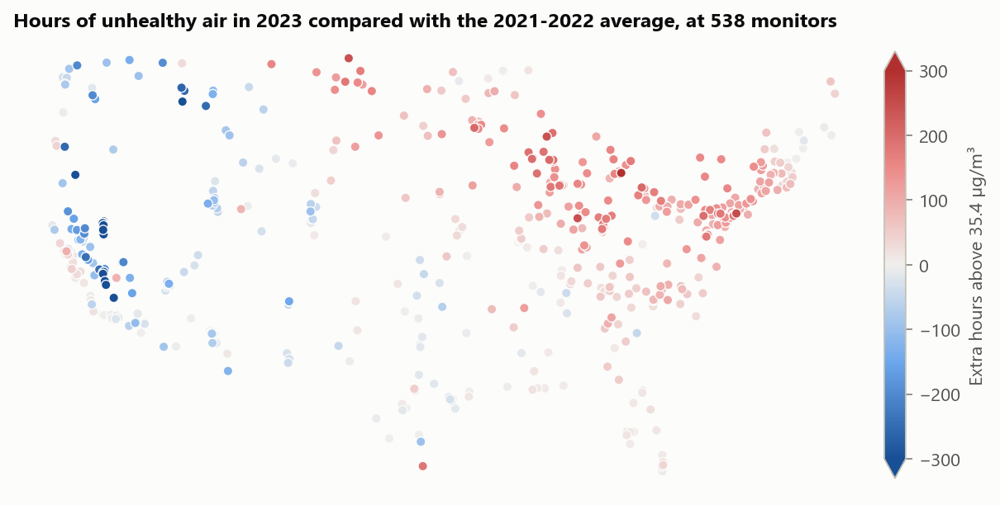
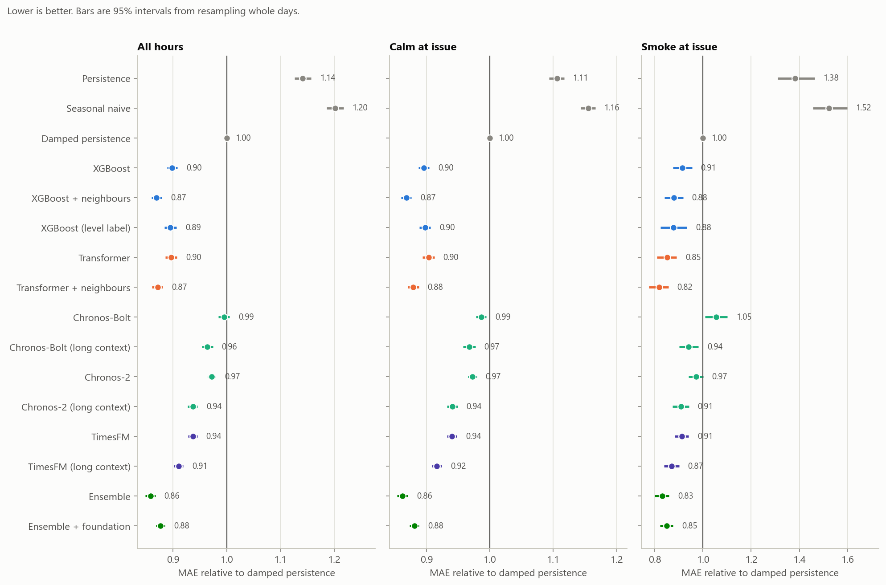
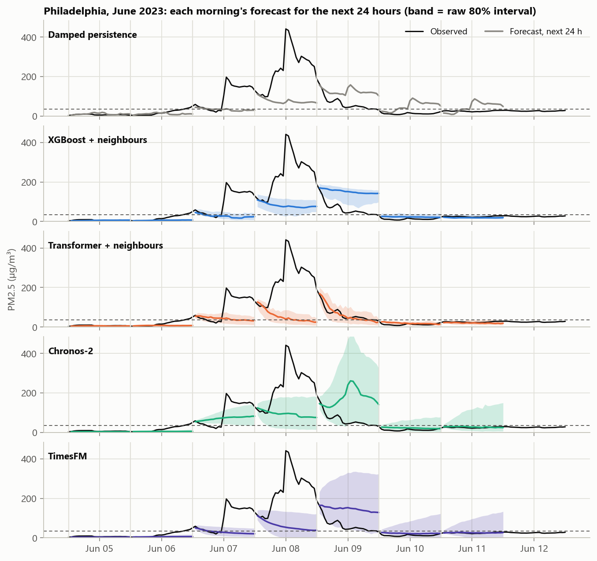

# SmokeShift

**Which forecasts survive wildfire smoke?**

A benchmark of 16 forecasting methods on 538 US air quality monitors. Every model is fixed using data from
before the record 2023 wildfire-smoke season and then tested through it: naive rules, gradient-boosted trees, a
transformer written in PyTorch, and zero-shot foundation models from Amazon and Google.



In June 2023, smoke from Canadian wildfires gave much of the eastern United States its worst air on record. Little
in the previous two years of data looked like it. That makes it a natural experiment for a question every
deployed model eventually faces: **what happens when the world leaves the training distribution, and how do you
measure it honestly?**

| | |
|---|---|
| Write-up | [`outputs/report.html`](outputs/report.html) (download and open in a browser) |
| Interactive dashboard | [`dashboard/index.html`](dashboard/index.html) |
| How the code works | [`docs/CODE_GUIDE.md`](docs/CODE_GUIDE.md), [`docs/API_REFERENCE.md`](docs/API_REFERENCE.md) |
| Why these methods | [`docs/CONCEPTS.md`](docs/CONCEPTS.md) |
| What is installed where | [`docs/INSTALLED.md`](docs/INSTALLED.md) |
| Running on Colab | [`docs/COLAB.md`](docs/COLAB.md), [`notebooks/smokeshift_colab.ipynb`](notebooks/smokeshift_colab.ipynb) |

## Contents

- [Findings](#findings)
- [Leaderboard](#leaderboard)
- [Run it on your own computer](#run-it-on-your-own-computer)
- [Run it on Google Colab](#run-it-on-google-colab)
- [Stages and run times](#stages-and-run-times)
- [The data](#the-data)
- [The benchmark protocol](#the-benchmark-protocol)
- [The models](#the-models)
- [Repository layout](#repository-layout)
- [Tests](#tests)
- [Limits](#limits)
- [References](#references)

## Findings

All numbers come from the tables in `outputs/tables/`, which the pipeline writes.

1. **The shift is large, regional and in the tail.** The Northeast had 5.7 times as many hours above 35.4 µg/m³
   in 2023 as in 2022, and 98% of its monitors got worse (paired Wilcoxon test, p < 0.001). The West got cleaner.
   A standard drift statistic on the whole distribution (Kolmogorov-Smirnov) says the quiet year 2024 moved
   further from training than 2023 did. The 99.9th percentile says the opposite: 2.8 times its training value in
   2023 and 0.6 times in 2024.

2. **Models trained on the data beat every naive rule.** The best single model has 13% lower error than damped
   persistence, with a day-block bootstrap interval of 12% to 14%. Averaging the trees and the transformer, with
   nothing fitted, is best (3.46 µg/m³).

3. **Trees and transformer tie, and that is measured, not assumed.** Each transformer was trained with five
   random seeds. With neighbours its overall error is 3.53 ± 0.02 µg/m³ (range 3.51 to 3.56), and the tree model's
   3.51 falls inside that range. With smoke present the transformer is better in every run (8.96 to 9.27 against
   9.66), so that advantage is real.

4. **How the test set is sliced decides who wins.** Scored only on hours that turned out to be elevated, plain
   persistence ranks 1st of 16. Scored on a stratum known at forecast time (smoke present in the previous 24
   hours), it ranks 15th. Same forecasts. Selecting on the outcome rewards any forecast that leans high, which is
   known as the forecaster's dilemma, so every ranking here uses forecast-time strata.

   

5. **Zero-shot foundation models beat naive rules but not local training.** With the same 168 hours of input and
   no training, Google's TimesFM has 6% lower error than damped persistence and 4.5% higher error than the best
   model trained here on the same information. Amazon's Chronos-2 is 3% better than damped persistence, and the
   older Chronos-Bolt only matches it. Three weeks of history instead of one improves all three by about 3%, and
   brings TimesFM to within 1.5% of the trained model that sees one week. One caution: these models were released
   in 2024 and 2025 and may have been pretrained on series from the test years.

6. **Neighbours matter most where history is silent.** Adding what surrounding monitors are reading improves
   average error by about 3%, but improves skill at warning that a clean day will turn unhealthy by a factor of
   1.7 (PR-AUC). Across five seeds that skill is 0.26 ± 0.02 with neighbours and 0.14 ± 0.02 without; every run
   with neighbours beats every run without. At 50% precision, methods that see only one monitor's history,
   foundation models included, catch at most 11% of such onsets. The transformer with neighbours catches 22%.

7. **Calibrated on average is not warned.** Raw 80% intervals cover 79%. Adaptive conformal calibration restores
   80.0% overall and 79% with smoke present. But of the hours that became onsets, no method's interval contained
   more than 8%.

8. **More compute did not buy accuracy.** The transformer was trained at two sizes: 1.1 million parameters on the
   CPU and 1.6 million on the GPU. Both reached the same validation loss. Adding two foundation models to the
   ensemble made it slightly worse (3.46 to 3.54). The limit is information, not model size.

9. **A sound argument is not a result.** The tree models predict the change from the latest reading, on the
   reasoning that trees trained on levels are capped at the highest level seen in training. The ablation confirms
   the cap on the most extreme hours and shows it makes no difference on average (0.4%).

10. **Multiple testing at scale.** Testing 538 monitors for a weekday effect gives 58 "significant" results at
    p < 0.05, against 27 expected by chance. False-discovery-rate control leaves 4.



No model forecast the peak. That picture is the honest summary of the project.

## Leaderboard

Test period 2023 and 2024: 729 daily forecasts at 538 monitors, 48 hours ahead, 17.8 million forecast-hours,
identical cells for every model. Lower is better.

| Model | MAE, µg/m³ | vs damped persistence (95% interval) | Quantile loss | MAE, smoke at issue |
|---|---|---|---|---|
| Ensemble | 3.46 | 0.858 (0.848 to 0.867) | 0.355 | 9.13 |
| XGBoost + neighbours | 3.51 | 0.869 (0.860 to 0.879) | 0.361 | 9.66 |
| Transformer + neighbours | 3.52 | 0.871 (0.861 to 0.881) | 0.361 | 8.99 |
| Ensemble + foundation | 3.54 | 0.877 (0.868 to 0.885) | 0.363 | 9.34 |
| XGBoost (level label) | 3.61 | 0.895 (0.884 to 0.907) | 0.372 | 9.65 |
| Transformer | 3.62 | 0.897 (0.886 to 0.907) | 0.372 | 9.35 |
| XGBoost | 3.63 | 0.898 (0.888 to 0.908) | 0.373 | 10.06 |
| TimesFM (long context) | 3.67 | 0.910 (0.902 to 0.919) | 0.378 | 9.57 |
| Chronos-2 (long context) | 3.78 | 0.937 (0.927 to 0.945) | 0.389 | 9.99 |
| TimesFM | 3.78 | 0.937 (0.928 to 0.945) | 0.390 | 10.04 |
| Chronos-Bolt (long context) | 3.89 | 0.964 (0.953 to 0.974) | 0.400 | 10.33 |
| Chronos-2 | 3.92 | 0.972 (0.964 to 0.979) | 0.404 | 10.68 |
| Chronos-Bolt | 4.02 | 0.995 (0.984 to 1.005) | 0.413 | 11.59 |
| Damped persistence | 4.04 | 1.000 | n/a | 11.00 |
| Persistence | 4.61 | 1.141 (1.126 to 1.157) | n/a | 15.20 |
| Seasonal naive | 4.85 | 1.202 (1.186 to 1.217) | n/a | 16.75 |

"Smoke at issue" means at least one reading above 35.4 µg/m³ in the 24 hours before the forecast. The models are
described in [The models](#the-models).

## Run it on your own computer

Yes, everything runs locally. All results in this repository were produced on a laptop with a 6 GB NVIDIA GTX
1660 Ti. A GPU makes it faster but is not required for anything except the foundation models, which are
impractically slow on a CPU.

**What you need:** Python 3.10 or 3.11, Git, about 20 GB of free disk space for a full run (17 GB is used), and
for the GPU stages an NVIDIA card with a current driver. The commands below are for Windows PowerShell.

**Step 1. Get the code.**

```powershell
git clone https://github.com/HameesSajid/smokeshift.git
cd smokeshift
```

**Step 2. Create the Python environment.** This makes a `.venv` folder inside the project and installs PyTorch
with GPU support, XGBoost, the two foundation-model packages and the scientific stack into it. Your normal Python
is not changed. It downloads about 2.5 GB and takes about ten minutes.

```powershell
powershell -ExecutionPolicy Bypass -File scripts\setup_env.ps1
```

On a machine without an NVIDIA GPU, or on macOS or Linux, do it by hand instead (there the interpreter is
`.venv/bin/python`):

```
python -m venv .venv
.venv\Scripts\python -m pip install torch numpy pandas scipy scikit-learn matplotlib xgboost pytest
.venv\Scripts\python -m pip install chronos-forecasting "timesfm[torch]"     # only for the foundation models
```

**Step 3. Check that it works.** Fourteen checks run on a small synthetic panel in a few seconds.

```powershell
.venv\Scripts\python tests\test_smokeshift.py
```

**Step 4. Look at what is already there.** The cleaned data panel (17 MB), every result table, the figures, the
report and the dashboard are in the repository, so you can open `outputs\report.html` and `dashboard\index.html`
straight away and rerun the light stages without training anything:

```powershell
.venv\Scripts\python run.py                 # lists the stages
.venv\Scripts\python run.py eda             # statistics of the 2023 shift, five figures (3 minutes)
.venv\Scripts\python run.py report          # rebuild the report from the tables
```

**Step 5. Reproduce the models.** Forecasts are large and are not in the repository, so scoring needs the models
to be run first. Either run everything:

```powershell
.venv\Scripts\python run.py all             # four to five hours on the laptop GPU
```

or go stage by stage, in this order:

```powershell
.venv\Scripts\python run.py naive                      # reference forecasts, under a minute
.venv\Scripts\python run.py gbm                        # three XGBoost models, 18 minutes on the GPU
.venv\Scripts\python run.py neural                     # two transformers, 6 minutes on the GPU
.venv\Scripts\python run.py foundation                 # six Chronos and TimesFM runs, about three hours on the GPU
.venv\Scripts\python run.py ensemble evaluate uncertainty alerts
.venv\Scripts\python run.py seeds                      # five seeds per transformer, 30 minutes on the GPU
.venv\Scripts\python run.py figures report dashboard
```

`tune` (33 minutes) is optional: the chosen XGBoost settings are stored in `outputs/tables/gbm_tuning.json` and
are reused. `download` and `panel` are only needed to rebuild the data panel from the raw EPA files.

**Step 6. Open the results.** `outputs\report.html` is the write-up. `dashboard\index.html` is the interactive
page. `outputs\tables\` holds every number.

**Where things are stored.** Everything lives inside the project folder. `.venv` is the environment (5 GB) and
`.cache` holds raw downloads, stored forecasts, trained models and pretrained weights (about 12 GB after a full
run). Git ignores both. Deleting the project folder removes everything; `docs/INSTALLED.md` has the details and
the commands to remove individual parts. To keep the cache on another drive, set the environment variable
`SMOKESHIFT_CACHE` before running.

**Using VS Code.** Open the `smokeshift` folder. The Python extension finds `.venv` by itself; if it asks, choose
`.venv\Scripts\python.exe` as the interpreter. Then run the commands above in the integrated terminal.

## Run it on Google Colab

Colab is useful if you have no NVIDIA GPU, or want to run all six foundation-model variants quickly.
[`docs/COLAB.md`](docs/COLAB.md) discusses when it is worth it.

1. Go to [colab.research.google.com](https://colab.research.google.com). Choose **File > Open notebook > GitHub**,
   enter `HameesSajid/smokeshift` and open `notebooks/smokeshift_colab.ipynb`. For a private repository, tick
   "Include private repos" and sign in to GitHub when asked.
2. Choose **Runtime > Change runtime type** and pick a GPU. T4 is enough.
3. Only if the repository is private: create a GitHub personal access token with read access to this repository
   and add it in Colab's **Secrets** panel (the key icon) under the name `GITHUB_TOKEN`, with notebook access
   switched on.
4. Run the cells from top to bottom. In section 2 run only one of the two storage cells: the first keeps large
   files on your Google Drive, the second keeps them on the temporary Colab disk.
5. The cells in section 4 run the models and the scoring. Remove model names from the foundation-model cell to
   save time.
6. The last cell downloads `smokeshift_results.zip`. Unzip it over your local project folder to bring the new
   tables, figures, report and dashboard data home, then commit and push.

The same commands work on any Linux machine with a GPU:

```
git clone https://github.com/HameesSajid/smokeshift && cd smokeshift
pip install chronos-forecasting "timesfm[torch]" xgboost
python run.py naive gbm neural foundation ensemble evaluate uncertainty alerts figures report dashboard
```

## Stages and run times

Measured on a laptop with a GTX 1660 Ti (6 GB).

| Stage | Command | Time | Needs |
|---|---|---|---|
| Download raw data | `python run.py download` | 4 min | internet |
| Build the panel | `python run.py panel` | 3 min | |
| Shift statistics | `python run.py eda` | 3 min | |
| Reference forecasts | `python run.py naive` | under 1 min | |
| Tune the trees | `python run.py tune` | 33 min | GPU recommended |
| Train the trees | `python run.py gbm` | 18 min | GPU recommended |
| Train the transformers | `python run.py neural` | 6 min on GPU, 30 min on CPU | PyTorch |
| Foundation models | `python run.py foundation` | about 3 h for all six (91 min for the first four) | GPU, optional packages |
| Ensembles | `python run.py ensemble` | under 1 min | |
| Score everything | `python run.py evaluate` | 4 min | |
| Intervals | `python run.py uncertainty` | 6 min | |
| Alerts | `python run.py alerts` | 1 min | |
| Seed spread | `python run.py seeds` | 30 min on an idle GPU | PyTorch, GPU recommended |
| Charts, report, dashboard | `python run.py figures report dashboard` | under 1 min | |

Stages are independent once their inputs exist. After adding or retraining a model, run
`ensemble evaluate uncertainty alerts figures report dashboard`.

The GPU is used automatically: XGBoost whenever it reports CUDA support, PyTorch whenever it was installed with
CUDA. Without a GPU the trees train with fewer rounds and the transformer uses a smaller preset.

## The data

- **Source.** US Environmental Protection Agency, Air Quality System, pre-generated hourly files for PM2.5
  (parameter 88101), 2021 to 2024. Public domain.
- **Raw size.** 35.6 million rows, one per instrument per hour.
- **Cleaning.** Contiguous US only. Instruments at the same site are averaged. Readings outside -10 to 1000 µg/m³
  are treated as missing. Sites must report at least 85% of hours in every one of the four years.
- **Result.** 538 monitors by 35,064 hours, 18.3 million observations, 3.1% missing. Stored in
  `data/processed/panel.npz` (17 MB), so the repository runs without downloading anything.
- **Missing values.** Never filled in the targets. Model inputs are forward-filled with a mask.

## The benchmark protocol

- **Task.** Each day at 12:00 UTC, forecast the next 48 hours at every monitor from at most 168 hours of history,
  as nine quantiles (10% to 90%).
- **Split.** Train before 2022-07-01. Validate July to December 2022. Test on 2023 (smoke) and 2024 (ordinary).
- **Common grid.** A forecast-hour counts only if every model produced a number and the truth was observed.
- **Scores.** MAE in µg/m³; MASE, which scales by each monitor's own difficulty; weighted quantile loss (WQL)
  for the predictive distribution; interval coverage and the Winkler score; PR-AUC and recall at fixed precision
  for next-day health alerts.
- **Strata.** "Calm at issue" and "smoke at issue" are defined by the 24 hours before the forecast.
  Outcome-selected slices are reported only as diagnostics.
- **Uncertainty in the comparison.** Whole days are resampled 1,000 times, because a plume makes errors at
  different monitors on the same day dependent.
- **No leakage.** Automated tests corrupt all data after a cut-off and assert that no feature, model input or
  baseline before it changes.

## The models

| Model | What it is |
|---|---|
| Persistence | The latest reading, repeated |
| Seasonal naive | The same clock hour on the latest observed day |
| Damped persistence | Weekly hourly profile plus a decaying share of the current anomaly; one fitted number per horizon |
| XGBoost | One global gradient-boosted model for all monitors and horizons, nine quantiles, own history only |
| XGBoost + neighbours | The same, plus 16 features describing monitors up to 800 km away |
| XGBoost (level label) | Ablation: predicts the level instead of the change from the latest reading |
| Transformer | A patch transformer written in PyTorch, own history only |
| Transformer + neighbours | The same, with two neighbour input channels |
| Chronos-Bolt | Amazon's 2024 pretrained forecasting model, zero-shot, 168 hours of history |
| Chronos-2 | Amazon's 2025 pretrained forecasting model, zero-shot, 168 hours of history |
| Chronos-Bolt (long context), Chronos-2 (long context), TimesFM (long context) | The same three models given 512 hours of history |
| TimesFM | Google's pretrained forecasting model (version 2.5), zero-shot, 168 hours of history |
| Ensemble | Equal-weight average of the two neighbour-aware trained models |
| Ensemble + foundation | Those two plus Chronos-2 and TimesFM, membership fixed before scoring |

## Repository layout

```
run.py                      command-line entry point
src/smokeshift/
  config.py                 paths and the experimental design
  download.py, panel.py     raw EPA files -> monitor-by-hour panel
  bench.py                  the protocol: issue times, contexts, targets, eligibility
  eda.py                    shift statistics, FDR, correlogram, principal components, plume lags
  naive.py                  persistence, seasonal naive, damped persistence
  spatial.py, features.py   neighbour features and the tabular design
  gbm.py                    XGBoost quantile models, tuning, TreeSHAP
  neural.py                 patch transformer in PyTorch
  seeds.py                  run-to-run spread over five training seeds
  foundation.py             zero-shot Chronos-Bolt, Chronos-2 and TimesFM
  store.py                  forecasts on disk, memory-mapped
  conformal.py              static and adaptive conformal intervals
  metrics.py, evaluate.py   scoring on the common grid
  uncertainty.py, alerts.py interval evaluation; next-day health alerts
  figures.py, plotting.py   charts
  report.py, export.py      the HTML report; the dashboard bundle
  pipeline.py               the stages, in order
tests/test_smokeshift.py    leakage and protocol checks
scripts/                    environment setup, GPU queue, API-reference generator
notebooks/                  Colab runner
docs/                       code guide, API reference, concepts, install log, Colab advice
outputs/                    report.html, 13 figures, result tables
dashboard/                  interactive page and its data bundle
data/processed/             the cleaned panel, monitor table and raw-file checksums
.venv/, .cache/             created when you run it; ignored by git
```

## Tests

```
python tests/test_smokeshift.py      # or: pytest
```

Fourteen checks run on a small synthetic panel in a few seconds. Four of them corrupt every value after a cut-off
and assert that tree features, neighbour features, reference forecasts and transformer inputs before the cut-off
do not change. The rest cover the split, gap filling, the scores, adaptive conformal coverage under a simulated
shift, the multiple-testing procedure, storage, distances, and that `docs/API_REFERENCE.md` matches the code.
A GitHub Actions workflow runs them on every push.

## Limits

- **No meteorology.** Wind, mixing height and smoke-plume forecasts are what operational systems use to predict
  onsets. Neighbour readings only help once a plume has reached a neighbour. Two days ahead, no method here gives
  a useful warning (best PR-AUC 0.15).
- **One shift.** Conclusions about behaviour under shift rest on one extraordinary season.
- **Foundation-model pretraining is not fully documented** and may include the test years.
- **"Elevated" is not always smoke.** Inversions, fireworks and dust also cross the threshold.
- **Seed variation is measured for the transformer only** (five runs each). The tree models were each trained
  once.

`docs/CONCEPTS.md` lists, topic by topic, what was used, what else could be, and what is missing.

## References

- US EPA, Air Quality System pre-generated data files, https://aqs.epa.gov/aqsweb/airdata/download_files.html
- S. Lerch, T. Thorarinsdottir, F. Ravazzolo, T. Gneiting, "Forecaster's dilemma: extreme events and forecast
  evaluation," Statistical Science, 2017.
- Y. Nie et al., "A time series is worth 64 words: long-term forecasting with transformers," ICLR 2023.
- T. Chen, C. Guestrin, "XGBoost: a scalable tree boosting system," KDD 2016.
- A. Ansari et al., "Chronos: learning the language of time series," TMLR 2024.
- A. Das, W. Kong, R. Sen, Y. Zhou, "A decoder-only foundation model for time-series forecasting," ICML 2024.
- Y. Romano, E. Patterson, E. Candès, "Conformalized quantile regression," NeurIPS 2019.
- I. Gibbs, E. Candès, "Adaptive conformal inference under distribution shift," NeurIPS 2021.
- S. Lundberg et al., "From local explanations to global understanding with explainable AI for trees," Nature
  Machine Intelligence, 2020.
- Y. Benjamini, Y. Hochberg, "Controlling the false discovery rate," Journal of the Royal Statistical Society B,
  1995.
- R. Hyndman, A. Koehler, "Another look at measures of forecast accuracy," International Journal of Forecasting,
  2006.
